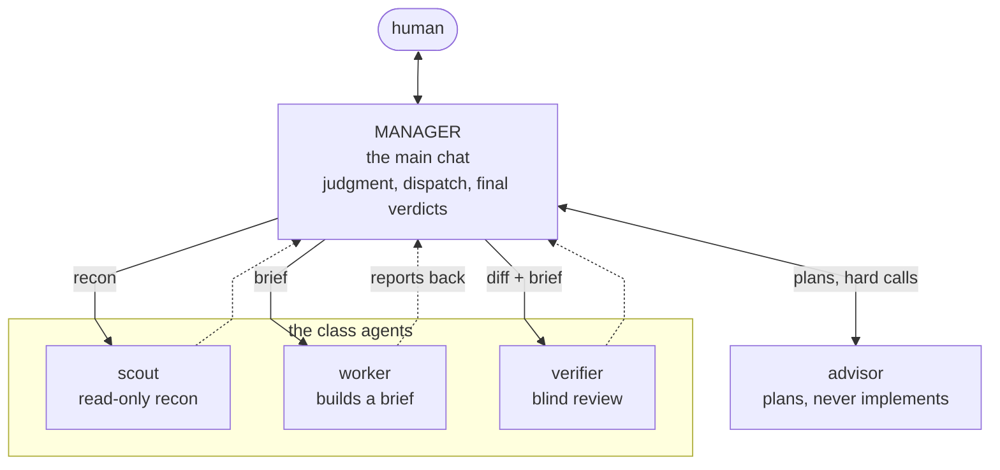

# Agents: the workkit crew

- Agent definitions shipped by the workkit plugin.
- They surface in a session namespaced as `workkit:<name>`.
- **An agent exists here only if a flow dispatches it**.
  - Unrouted agents are dead weight.
  - Every definition names its dispatcher below.

## Roster

| Agent | File | Dispatched by |
|---|---|---|
| `workkit:reviewer` | `reviewer.md` | the `workkit:review` flow (compliance lens) |
| `workkit:scout` | `scout.md` | the manager profile (recon) + `workkit:review` lenses |
| `workkit:worker` | `worker.md` | the manager profile (implementation) |
| `workkit:verifier` | `verifier.md` | `workkit:review` scorer/light tier + the manager profile |
| `workkit:advisor` | `advisor.md` | the manager profile, in sessions below the frontier tier |

## Classes (the manager system)

- `scout` / `worker` / `verifier` / `advisor` are the CAPABILITY CLASSES of the manager system.
- Their concrete model is supplied per spawn by the `manager/resolver` hook, from three inputs:
  - `../hooks/manager/resources/ladder.json` (the rungs and the classes);
  - the `manager.tiers` setting (its defaults in `../defaults/settings.json`);
  - the LIVE session model.
- A mid-session `/model` switch takes effect on the next spawn.
- The `model:` frontmatter in these four files is only the static fallback for when the hook is disabled.
  - Never treat it as the routing truth.
  - Never pass a `model` param when dispatching them.
- Effort is the other way round: the ladder sets models only.
  - Each class's effort lives in its own file's `effort:` frontmatter line, the one place Claude Code reads it.
  - The Agent tool takes no effort per spawn.
  - An agent file with no `effort:` line follows the session's.

- The manager is whichever model the chat runs on, so the topology follows the session's model.
  - A frontier session never spawns the advisor.
  - A workhorse session consults it for plans and hard calls.
- Test scope is doctrine for every class, the manager included.
  - A worker's mid-work proof is the test files it touched, red-green on the new cases.
    - Then the suites of the modules that require a file it changed (its importers, one grep of the package's source per changed file).
  - A verifier runs the narrowest command that checks the claim.
  - None of them runs a package or root suite unless the brief asks or the finding is suite-scoped.
    - Even then a root run waits until every item is parked.
- The full suite runs once per tree, as `npm test` at the repo root before the commit.
  - The shell records the tree it proved, and the gate checks the record (spec § The proof).
  - In a Claude session the full-suite hold (`workflow/lib/hold.sh`) refuses two runs, from any class:
    - a repeat full run on a tree already proved green;
    - any root run while an issue of the repo is at `status:building`.
- The per-feature proof is enforced too.
  - At the flip to `status:qa`, `safety:proof-guard` runs nothing.
  - It blocks until each package owning a touched test file has a green `npm test` recorded on its own id of the tree.
  - The rule is the spec's: `project-state.md` § The proof.
- Drift is verifier doctrine: every blind verification also asks the three DRIFT questions past its brief.
  - Parity siblings on the other surfaces.
  - Duplicates of anything hand-typed the diff adds (found by grep).
  - The docs the change made stale.
- The DRIFT questions live in `../agents/verifier.md` § Behavior.
  - That section quotes the Parity mandate `../skills/review/SKILL.md` § 2 owns.
  - They are asked per group, each group's verifier over its group's diff.
  - The batch's one review panel carries the check across groups through its Parity lens (§ Batches).
- The worker carries the other half of the same ruling (`../agents/worker.md`, fix the class).
  - A hand-typed thing found wrong once is grepped across every package.
  - It is fixed at the sites the brief covers, and every other site is NAMED in the report.
- The wider counterpart is per SHIP, not per batch: `workkit:ship` reviews the whole ship diff every time.
  - It is light when the full-panel review marker already covers it, and full otherwise.
  - The rule: `../skills/ship/SKILL.md` step 3.2b.
- Visibility is manager doctrine, injected every prompt by the `manager/profile` hook.
  - Keep a visible checklist with the todo tool for any multi-step task, kept current as steps start and finish.
  - Announce every crew spawn in chat as it is made (class, model per the ladder, one-line mandate).
  - Report what it returned.

### Crew sizing

- The manager stages the crew to the task rather than assembling it all at once.
  - A small change is the manager alone (a line or a function, no spawn).
  - Every build past that is a feature-developer and test-developer pair on the shared tree (below).
    - It is one pair per group in a batch (§ Batches), save a group with no test surface.
  - The `verifier` runs twice: when the build claims done, and over the review's fixes (`skills/feature/SKILL.md` § 5).
  - The full review panel assembles only inside `workkit:review` and `workkit:ship`.
- `scout` is recon. Dispatch it at any point.
- Dispatch is one level deep throughout (§ Definition rules), so every stage is the manager's to open and close.
- The manager keeps `.workkit/agents/session.md` current as it goes.
  - It holds the task queue and quick notes.
  - Durable facts are promoted to their issue the moment they exist.
- Design calls, contract changes, final verdicts, and anything security-adjacent stay the manager's, never the crew's.
- The self-edit line: the manager edits inline only when doing the edit costs fewer tokens than briefing a worker.
  - In practice that is up to a line or a function.
  - Anything larger goes to a pair and gets the blind verify.
- The pair is two `workkit:worker` briefs:
  - a **feature-developer** who edits only the group's source paths;
  - a **test-developer** who edits only its test paths.
- Each brief names its paths, and neither role reads the other's files.
- Both build from the issue's `### Contract` (`project-state.md` § Specs), so no agent writes a test to fit its own code.
- A test-developer who cannot write a failing test from the Contract reports it.
  - That is a Contract defect for the manager, never a test rewritten to fit.
- A test the feature-developer believes wrong is reported, never edited; the manager rules.
- The test-developer's own run of its test files on the shared tree is informational.
  - It reports what it saw, red or green, since the feature-developer may be mid-edit.
  - The verifier's red proof is the proof.
- Two roles running one package's tests at the same moment within a pair is an accepted race.

- Red first is proven by execution, not by sequence.
- The group's verifier runs `workkit proof red <source paths> -- npm test -- <test files>`.
  - Where the root runner takes no arguments, the verifier runs the runner's own narrow command instead.
    - Red-proof takes any command.
  - The command runs the tests in a copy of the tree holding the source paths as the claim found them.
  - Red is expected: the tests fail without the source.
  - The verifier then runs the test files on the shared tree itself (green).
- The copy is the claim's snapshot plus the working changes since.
- The snapshot is the whole repo folder that the `workflow:snapshot` hook copies when an issue moves to `status:building`.
  - Gitignored files (`dist/`, `.env`) are included.
  - Each package's `node_modules` and the kit's own paths are left out.
  - The full list: `hooks.md` § `workflow:snapshot`.
- Each run adds a git worktree of HEAD, so the copy stays a git repo.
  - It sits in the run's own folder, `~/.cache/workkit/proof/<id>/copy`, never in the system temp folder.
  - It checks HEAD out into it as the floor, so a tracked file the snapshot lacks is HEAD's.
  - It fills it from the snapshot.
  - Then each of these paths gets its live version, or is removed when the live tree lacks it:
    - every path among the working changes now;
    - the working changes at the snapshot;
    - the files changed between the snapshot's HEAD and HEAD.
- The source paths are the exception: they stay as the snapshot holds them.
  - One the snapshot lacks is removed from the copy after the fill, even where HEAD holds it.
- Every gitignored file comes from the snapshot.
- The snapshot holds no package's `node_modules` folder on any platform.
  - So the run makes each one a real folder in the copy and links its entries from the live repo.
  - The exception is a workspace link (one resolving inside the repo root and outside every `node_modules`).
    - It points at the same path inside the copy.
  - A scope folder and `.bin` are filled one level down, so a bin that runs a workspace package runs the copy's.
- A repo with no snapshot exits 2 with `red-proof: not runnable: no snapshot for this repo (the claim to status:building takes it)`.
- A failed run whose output shows a module that could not load inside the copy exits 2, never red.
  - The signs: node's `Cannot find module` or `Cannot find package`, code `MODULE_NOT_FOUND` or `ERR_MODULE_NOT_FOUND`.
  - Its requiring file or module path is in the copy.
  - The line: `red-proof: not runnable: a module failed to load: <module>`.
  - A missing module that resolves to a source path is absent by design and stays red.
    - A source path here is the path, the path less its extension, or a file in a source folder.
    - The module resolves in each of three spellings node reports it in:
      - its own path, relative to the requiring file or absolute;
      - its path through a workspace link, the nearest folder that exists resolved through links;
      - a bare specifier with a subpath (`@scope/a/new`), against its package folder in the nearest `node_modules` at or above the requiring file.
    - A bare package name with no subpath, or a package not there, never resolves.
  - The same message about any other folder, a test merely printing it, is ignored.
- When the output carries node's whole summary block, the block decides.
  - The block is its eight lines `tests`, `suites`, `pass`, `fail`, `cancelled`, `skipped`, `todo`, `duration_ms`.
    - They come in that order at column zero under one prefix, `# ` under tap or `ℹ ` under spec.
  - `tests` is summed over every block it prints.
  - `fail` and `cancelled` together are the failed count, so a timed-out or hook-cancelled test is a red.
  - A block counting no test exits 2 with `red-proof: not runnable: no test ran`, never green.
  - A failing run whose blocks count no failed test exits 2, never red.
    - The line: `red-proof: not runnable: no test failed; the command stopped another way`.
  - A fragment, an indented quote or a reprefixed line never counts.
  - A command that prints no block is still judged by its exit code and the verifier's read of its output.
- That check has one accepted limit: a runner or a test that reprints a child's whole block at column zero counts it.
  - Node's spec reporter echoes a test's stdout raw, while tap escapes it.
  - The kit's runner and harness indent a child's text and a case's own prints.
  - So what still reaches column zero is three things:
    - a print outside any case;
    - a direct write to a file descriptor;
    - a child process started with inherited stdio.
- The accepted limits:
  - a build folder already stale when the snapshot was taken can still mislead a test;
  - work never claimed (an edit outside the feature flow) has no snapshot and exits 2;
  - a test that needs the changed code's own new build output exits 2 through the load check;
  - a dependency installed after the claim is visible to the copy, since its `node_modules` entries are the live ones.
- The verifier reads the command's output before accepting a red.
  - It reports an environmental red as a finding, never as the proof.
- The verifier is one per group, blind over the group's merged diff, both roles' paths.
  - Its questions are `../agents/verifier.md`'s.

- A suite that talks to a running server runs the server's code, not the copy's.
  - Example: an OMEGA backend route suite against an adopted emulator sends its requests to functions served from the live tree.
  - So the copy's red is hollow.
- For it the verifier runs `workkit proof red --live <source paths> -- <command>`. No copy is made.
  - Each source path's live version is moved under the run's own folder, `~/.cache/workkit/proof/<id>`.
  - The snapshot's version is put in its place (or none, where the snapshot lacks it).
  - The command runs where the caller stands.
  - The EXIT trap moves every live version back, once, on red, green, a stop, HUP, INT or TERM.
    - A signal the command does not share takes effect when the command ends.
- A named folder holding a package's `node_modules` is refused with exit 2.
  - The line: `red-proof: --live cannot name a folder holding node_modules: <rel>; name the files instead`.
  - The reason: the snapshot holds none to put back in its place.
- The verdict and exit codes are the copy mode's, and the load check judges a module under the repo root.
- Its limit: the live tree holds the old source for the run's length.
  - So no other agent may edit the named paths meanwhile.
- A group with no test surface (docs, skills, agent files, issue forms) is ONE worker with no test-developer.
  - Its verifier skips the red proof and says so.
  - The `Proof:` line records `red-proof: none (no test surface)` (`project-state.md` § The proof).

### Batches

- Several authorized issues are always one batch when related, and several batches otherwise.
  - Related is as `project-state.md` § Queue semantics defines it.
  - Every batch is built in parallel groups, never asked about.
- Inside a batch every issue builds at once.
  - The manager never serializes the issues of a batch unless the owner asks.
  - A shared seam is handled by grouping, never by waiting.
- Batches run one at a time, the next starting once the current one has parked.
- The manager picks the issues of each batch and the order of the batches, unless the owner directs either.
  - The manager's own earlier plan, order, or session file never serializes a batch.
  - Order belongs to batches and ships, never to the issues inside one.
- The start rule: a batch is what is specced and authorized the moment the manager has hands free, and it spawns then.
  - A specced issue never waits for another issue's Spec.
  - Nor for an answer to a question about other work, or for a ship question about a parked batch.
- A member may arrive while the batch builds (a new Spec accepted, an inbox item the owner dictates).
  - It joins the batch as a new group when its seams are free of every running group's files.
  - Else it starts the next batch.
  - The grouping comment on its claim says which.
- A parked batch on the tree is no reason to wait.
  - The next batch builds on top of it, and the ship carries what passed.
- The one hold is the full-suite hold's: an issue at `status:building` holds the root `npm test`.
  - So a ship waits until every running group has parked.
- A batch (`project-state.md` § Queue semantics, the Batches bullet) builds in parallel groups on the shared tree.
  - It rides one commit and one ship.
- The session is the only manager.
- Before any spawn the manager groups the batch's issues by three forces in order, a later one never overriding an earlier:
  - dependency edges: a blocker and its dependent are never in different concurrent groups;
  - then shared seams: issues touching one file, module or package go in one group;
    - so two workers never write one file or run one package's prepare or tests at the same moment;
  - then size balance.
- The grouping is said in chat and recorded on each issue's claim comment.
- Each group gets ONE pair (§ Crew sizing), a feature-developer brief and a test-developer brief.
  - Every group's pair is launched in one message.
- Each group gets ONE verifier, blind over that group's merged diff against both briefs.
  - The briefs name the group's files.
  - The verifier reads `git diff HEAD -- <those paths>` plus `git status --short -- <those paths>` for new files.
  - No other group touches those files.
- A ≥80 finding the fix-or-file rule keeps goes back to that group's pair for one round.
  - It goes to the role whose paths it names.
- The manager does not edit the tree while group workers run: a manager edit lands inside a running worker's files.
- Once every group's verifier has reported and its fix round has landed, ONE `workkit:review` full panel reads the whole batch diff.
  - It is never one per issue.
  - Its marker is what the commit's gate reads.
- Then, in order:
  - one light verification pass over the panel's fixes;
  - one worker round;
  - the review marker retouched so it covers the parked diff (`skills/feature/SKILL.md` § 5);
  - the park of every issue.
- The ends are per issue.
  - At the front: the spec pass and the claim.
  - At the back: the park and the check (the owner's check, or the agent's own under `agent:ok`).
- The commit is one per batch, proved by the root `npm test`.
- `agent:ok` decides who checks and whether the agent ships, never how the build runs.
- The qa flip's `safety:proof-guard` check covers every test file the working diff touched.
  - For a batch that is the union of its groups.
  - Each package owning one needs a green `npm test` recorded on its own id of the parked tree.
    - The id is the code it can see; the package id bullet of `docs/hooks.md` § `safety:proof-guard`.
  - So a package runs again only when an edit it can see lands.
  - Every flip on that unchanged tree passes on those records.

### Questions to the owner

- A decision put to the owner is SELF-CONTAINED: the question carries its full background in plain words.
  - The background: what the item is, why it needs a decision now, and what each choice means in consequence.
  - It is written for an owner who has read nothing else this session.
- The shape of the question itself is the `workkit:interview` skill's, § How questions are asked.
  - The shape: numbered, a plain paragraph first, options as nested bullets with the recommended one first and bold.
  - It binds every decision put to the owner.
- Unrelated decisions still batch into one pass: the questions arrive together, each standing alone.
- A question in the owner's prompt is answered first in the reply.
  - Work the same prompt authorizes starts in the same turn.

### Watching a run

- A run the manager starts in the background is one the supervisor reads, never a bare background command:
  - any `npm test` npm's script shell runs, the root's and a narrowed `npm test -- <files>` alike, or `workkit test` from any folder of the repo;
  - `workkit prove`;
  - or `workkit supervise -- <command>`, for any other run (a lane, a build).
- Wrapping one of the first two in `workkit supervise` changes nothing: it runs inside that one supervised run.
- The supervised call ends with the command's own code, 124 after a frozen end, or 125 on a look.
  - A narrowed run's output ends with `script-shell: exit <code>`, its stderr on stdout.
  - The checks, the verdicts and the evidence: `tests.md` § The checks.
- On 125 the manager reads the evidence and the log's last lines.
  - A run that still moves gets `workkit watch`.
  - A run that goes in circles gets `workkit watch --end`.
  - A narrowed run is named by the pid its look line prints (`workkit watch <pid>`); with several live, an unnamed call names each and exits 2.
  - Each runs as its own Bash call, since its allow rule matches the bare call alone.
- After a frozen end, or an end it asked for, the manager reads the evidence and finds the cause.
  - A bug it can reach is fixed and the run started again.
  - A one-time cause is a rerun.
- It goes to the owner only when it is out of moves:
  - the same freeze comes back with no cause found;
  - or the fix sits in a repo the session may not change.
- The manager may end, without asking, a run its own session started.
  - It never ends a process the run did not start.
- Every freeze, its cause and what was done are said in the report.

## Agents from other repos

- A session's agents come from three places:
  - any plugin ships them in its own `agents/` directory (this repo's, namespaced `workkit:`, is one such set);
  - a repo ships them in `.claude/agents/`;
  - a user in `~/.claude/agents/`.
- Precedence on a name collision is **project > user > plugin**.
- The `manager/resolver` hook routes ONLY the four workkit classes above.
  - Every other `subagent_type`, foreign or built-in, passes through untouched.
- So a foreign agent's `model:` frontmatter IS its contract.
  - Nothing here overrides it, and nothing here needs to know it exists.
- Ladder routing for foreign agents is deliberately unbuilt.
  - It waits for a real consumer to name what it needs.

## Personal add-ons

- A workkit agent is customized by STACKING onto it, never by replacing it.
  - The flows always dispatch `workkit:<name>`, and a personal layer adds to that agent at spawn.
- **Where it lives**: `~/.workkit/agents/<name>.md` (the workkit GLOBAL layer; `WORKFLOW_HOME` moves it).
  - One file per agent, named by the agent's bare name.
  - `scout.md` stacks onto `workkit:scout`, `reviewer.md` onto `workkit:reviewer`.
- **How it arrives**: the `manager:addon` hook (SubagentStart) reads the file each time that agent spawns.
  - It adds its text to the agent's context, under a one-line header naming the file.
  - One mechanism serves every workkit agent, present and future; there is no per-agent code.
- **What it can do**: add context.
  - Preloads, house rules, the skill or doc to read first, anything the agent should know before its first prompt.
- **What it cannot do**: change the agent's `tools`, `model` or `effort`, or remove anything the shipped definition says.
  - Those stay the agent file's (and the resolver's, for the model).
- **No file, or a blank one**: the agent runs exactly as shipped, which is the normal case.
  - A file that exists but cannot be read is an error, never a silent skip.
    - The error is a `manager:addon:` line naming it in the session's transcript (through `$.ui.log`).
  - The agent then runs as shipped, with no add-on context.
- A change to the file lands on the next spawn; no restart needed.

## File-handoff convention (all dispatches)

- A chat-inline brief bloats the dispatching context.
- A report file the dispatcher then has to open is a round trip nobody needs.
- So the two halves go opposite ways:

1. **Brief in a file.** The dispatcher writes the task brief to a file (session scratchpad dir).
   - It passes the path plus a 1–3 sentence dispatch line.
   - Briefs are **behavioral, not procedural**: state the goal, constraints, and done-criteria, not step-by-step file paths that go stale.
   - A brief file exists only for a dispatch being made now.
     - The spawn rides the same turn (or the owner explicitly asked for the file).
   - The owner saying "brief me" is asking for a chat summary, never a file.
   - A brief also NAMES the framework guide(s) the agent must read before its first edit.
     - So that reading is routed by the dispatcher instead of guessed at.
   - A brief starts from its role template in `../briefs/` (`<job>-<role>.md`, one per crew role).
     - The dispatcher fills the slots with the task's facts and restates nothing fixed.
   - Three layers, only the top one written per task:
     - the agent file says who the agent is;
     - the template what the job is;
     - the brief which task.
   - A fix round reuses the developer templates with the findings as the task.
   - The `{{kit}}` slot takes the plugin root's real path (`dirname "$(cd -P ~/.claude/workkit && pwd)"`).
     - The agent works in the task's repo, which may not be workkit.
     - Neither the Read tool nor a shell `cd` resolves `..` through the `~/.claude/workkit` link.
2. **Report inline.** The agent's final message IS the report.
   - It holds a completion status, commits if any, and the findings the dispatcher needs to act.
   - It is written for a reader who has not seen the work.
   - A finding or a line that restates an issue reads in the cold-reader line (`docs/project-state.md` § Restating an issue).
   - No report file, and no summary file beside it.
3. **A report FILE is the exception.** Only when the brief explicitly asks for one.
   - It is a large artifact meant to be read selectively rather than in chat.
   - Then the final message stays status, commits, and ONE line of result plus the path.

- Each agent file inlines the slice of this it needs, so it stays portable.
- This README is the full statement, not an import target.

### Completion statuses

| Status | Meaning |
|---|---|
| `DONE` | Done-criteria met, verified this run |
| `DONE_WITH_CONCERNS` | Done-criteria met; report lists risks/follow-ups |
| `BLOCKED` | Cannot proceed: report says what's missing and what was tried |
| `NEEDS_CONTEXT` | Brief is ambiguous: report lists the specific questions |

- After **3 failed attempts** at the same obstacle, stop and return `BLOCKED` with the attempts documented.
  - Don't burn the run retrying.

## Definition rules

- **Subagents NEVER spawn subagents.** One level of dispatch only.
  - The main session is the only dispatcher (reference: https://code.claude.com/docs/en/sub-agents).
- Frontmatter: `name`, `description`, `tools`, and for the class agents `model` (fallback only, § Classes) + `effort`.
  - `tools` is the minimum set: the list is also what mechanically keeps an agent from spawning subagents.
- **No knowledge in agent files**: agents define behavior and preloads; knowledge lives in skills/docs.
  - The reviewer's "derive the checklist from live docs" pattern is the model.
- **Every markdown file in `agents/` surfaces as an agent type**, which is why this document lives in `docs/` instead.
  - A contract kept beside the definitions would become a definition.
- **No machine-specific paths.** These files ship to any repo on any machine:
  - no absolute paths;
  - no pointers into a personal `~/.claude` tree beyond what every Claude Code install has;
  - no name of the owner's own repo.
  - The same scan covers the skills, agents, briefs, shipped docs and the `hooks/`, `workflow/`, `jobs/` and `tower/` READMEs.
- Repo-doc entry point: AGENTS.md.
  - A repo carries no `CLAUDE.md`; one still present is healed by the spec's § Repo docs.
